<div align="center">

  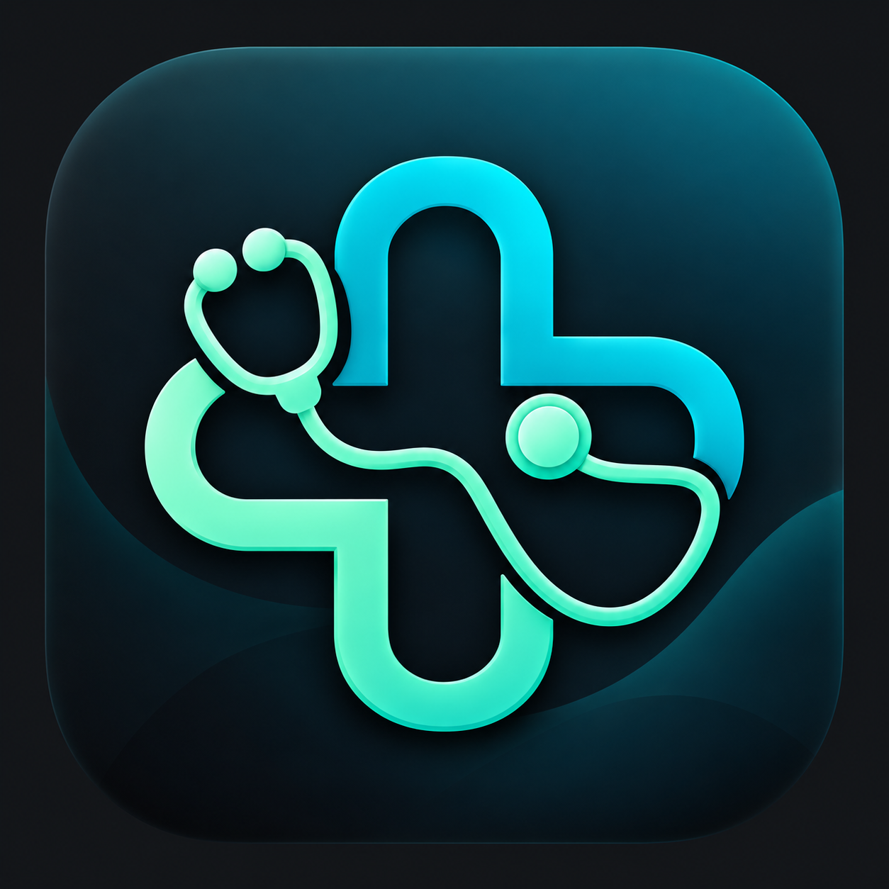

  # Se7ety - صحتي
  ### *A Modern, Full-Featured Healthcare & Doctor Appointment Booking Mobile Application*

  [](https://flutter.dev/)
  [](https://flutter.dev/)
  [](https://firebase.google.com/)
  [](https://pub.dev/packages/provider)
  [](https://flutter.dev/)

  ---

  <p align="center">
    <strong>Se7ety - صحتي</strong> is a comprehensive cross-platform Flutter application designed to seamlessly bridge the gap between healthcare providers and patients. It offers an intuitive platform for patients to discover top-rated doctors, search by specialty or name, book appointment slots in real time, and manage medical profiles—while empowering doctors with an active dashboard to review and manage patient booking requests efficiently.
  </p>

</div>

---

## 📋 Table of Contents

- [Overview](#-overview)
- [Key Features](#-key-features)
  - [Patient Experience](#-patient-experience)
  - [Doctor Experience](#-doctor-experience)
  - [Core & Shared Features](#-core--shared-features)
- [App Preview & Screenshots](#-app-preview--screenshots)
  - [1. Authentication & Onboarding](#1-authentication--onboarding)
  - [2. Patient Experience](#2-patient-experience)
  - [3. Doctor Experience](#3-doctor-experience)
  - [4. Appointment Management & Profile](#4-appointment-management--profile)
- [Technology Stack](#-technology-stack)
- [Architecture & Project Structure](#-architecture--project-structure)
- [Application Workflows](#-application-workflows)
- [Getting Started & Installation](#-getting-started--installation)
- [Key Engineering Highlights](#-key-engineering-highlights)
- [Future Enhancements](#-future-enhancements)
- [Author & Developer](#-author--developer)

---

## 🌟 Overview

Navigating healthcare services should be effortless, secure, and accessible. **Se7ety (صحتي)** reimagines the medical booking process by delivering a tailored experience for both patients and healthcare professionals. Built with **Flutter**, **Firebase Authentication**, **Cloud Firestore**, and **Provider**, Se7ety provides real-time state synchronization, atomic slot booking protection, and an elegant RTL-first Arabic user interface.

---

## ⚡ Key Features

### 👤 Patient Experience
* **Interactive Home Dashboard:** Personalized greetings, search field, medical specialties carousel, and top-rated doctor listings.
* **Specialty Discovery:** Browse doctors categorized by specialties (Cardiology, Pediatrics, Dentistry, Orthopedics, Dermatology, Ophthalmology, Neurology, Gynecology).
* **Smart Doctor Search:** Real-time filtering by doctor name or medical specialization with immediate query clearance.
* **Detailed Doctor Profiles:** View doctor credentials, clinic address, working hours, rating, bio, and direct phone contact information.
* **Real-Time Appointment Booking:** Select date and available time slots with automatic double-booking prevention.
* **Booking Management:** View appointment history categorized by status badges (*Pending*, *Confirmed/Accepted*, *Completed*, *Cancelled*), with one-tap pending cancellation.
* **Profile Management:** Edit full name, contact phone, and bio with real-time profile state refresh.

### 🩺 Doctor Experience
* **Dedicated Doctor Dashboard:** Personal control panel displaying doctor credentials, specialty, email, and active patient booking counters.
* **Patient Request Management:** View incoming patient appointments with contact details, date, time, and clinic location.
* **One-Tap Appointment Actions:** Confirm/Accept pending patient bookings or cancel appointments with confirmation dialogs.
* **Real-Time Synchronized State:** Immediate status updates propagated to both doctor and patient interfaces via Firestore transactions.

### 🔒 Core & Shared Features
* **Dual-Role Authentication:** Dedicated sign-in and account creation flows for Patient and Doctor roles.
* **Persistent Onboarding:** First-time launch walkthrough with onboarding slides, persisted via `SharedPreferences`.
* **RTL First & Localized Design:** Thoughtfully crafted Arabic RTL layout with proper handling of mixed LTR text fields (e.g., email addresses).
* **Responsive Layouts:** Scalable UI design matching phone dimensions using `flutter_screenutil`.

---

## 📱 App Preview & Screenshots

### 1. Authentication & Onboarding
<table align="center">
  <tr>
    <td align="center" width="33%">
      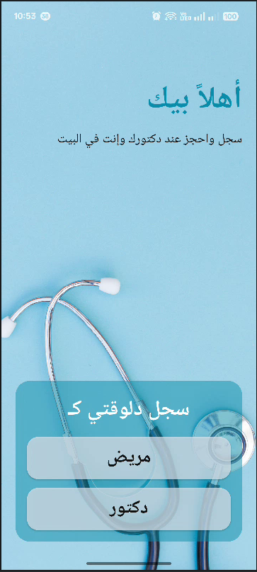
      <br />
      <sub><b>Account Selection Screen</b></sub>
    </td>
    <td align="center" width="33%">
      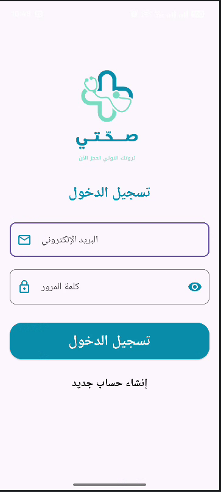
      <br />
      <sub><b>Login Page</b></sub>
    </td>
    <td align="center" width="33%">
      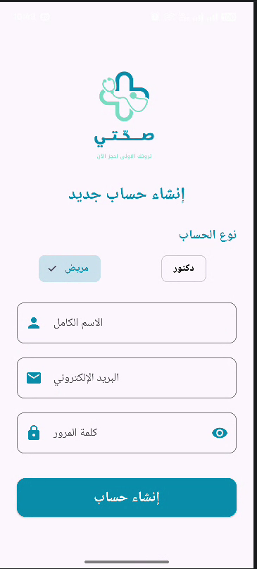
      <br />
      <sub><b>Patient Registration</b></sub>
    </td>
  </tr>
</table>

<table align="center">
  <tr>
    <td align="center" width="50%">
      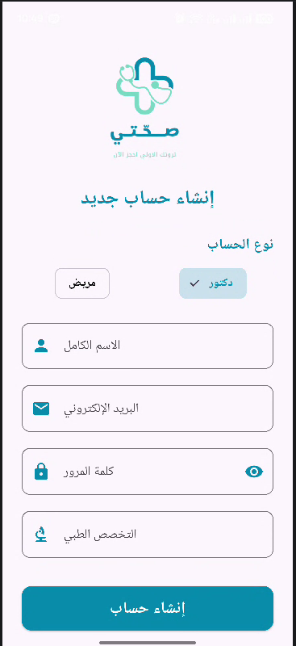
      <br />
      <sub><b>Doctor Registration (with Specialty)</b></sub>
    </td>
  </tr>
</table>

### 2. Patient Experience
<table align="center">
  <tr>
    <td align="center" width="33%">
      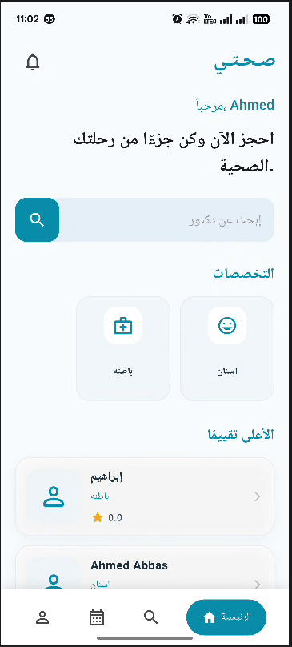
      <br />
      <sub><b>Patient Home Dashboard</b></sub>
    </td>
    <td align="center" width="33%">
      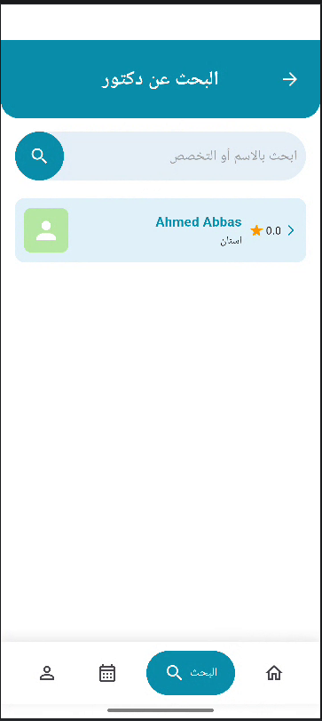
      <br />
      <sub><b>Doctor Search & Filtering</b></sub>
    </td>
    <td align="center" width="33%">
      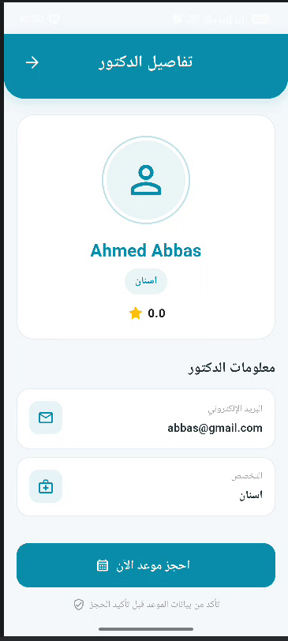
      <br />
      <sub><b>Doctor Details & Credentials</b></sub>
    </td>
  </tr>
</table>

### 3. Doctor Experience
<table align="center">
  <tr>
    <td align="center" width="50%">
      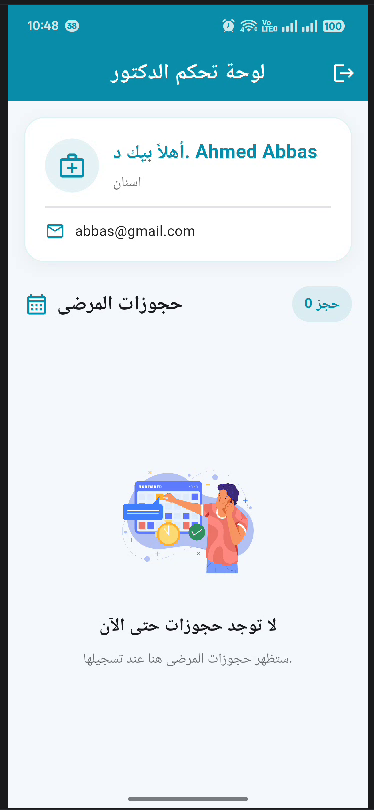
      <br />
      <sub><b>Doctor Dashboard & Patient Appointments</b></sub>
    </td>
  </tr>
</table>

### 4. Appointment Management & Profile
<table align="center">
  <tr>
    <td align="center" width="33%">
      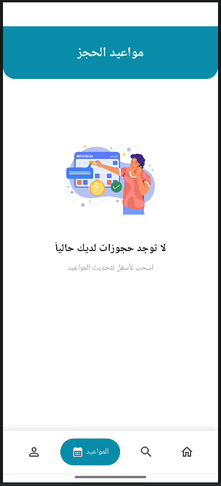
      <br />
      <sub><b>Patient Bookings History</b></sub>
    </td>
    <td align="center" width="33%">
      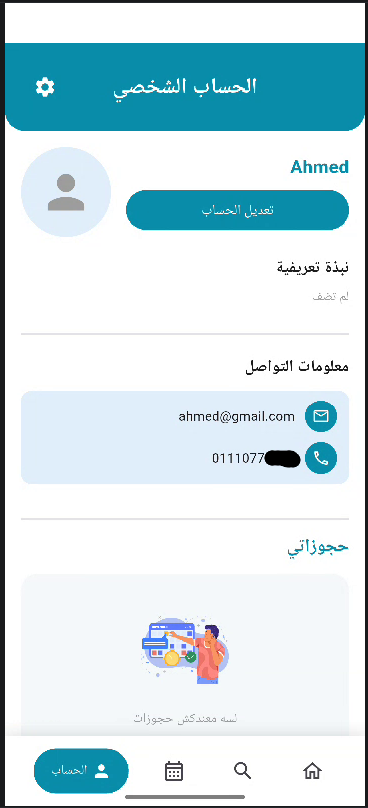
      <br />
      <sub><b>Patient Profile Page</b></sub>
    </td>
    <td align="center" width="33%">
      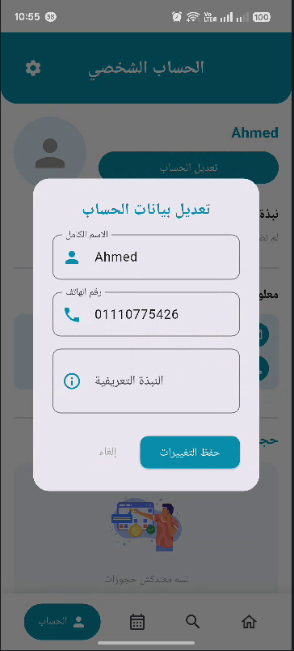
      <br />
      <sub><b>Edit Profile Dialog</b></sub>
    </td>
  </tr>
</table>

---

## 🛠 Technology Stack

* **Framework:** [Flutter](https://flutter.dev/) (v3.47+ / Stable Channel)
* **Programming Language:** [Dart](https://dart.dev/) (v3.13+)
* **Backend Services:**
  * **Firebase Core:** `firebase_core` (v4.15.0)
  * **Authentication:** `firebase_auth` (v6.7.0)
  * **Cloud Database:** `cloud_firestore` (v6.10.0)
* **State Management:** [Provider](https://pub.dev/packages/provider) (v6.1.5)
* **UI & Utilities:**
  * `flutter_screenutil` (Responsive design)
  * `introduction_screen` (Onboarding walkthrough)
  * `flutter_svg` (Vector illustrations)
  * `shared_preferences` (Local key-value persistence)
  * `dio` & `url_launcher` (HTTP networking & external links)

---

## 🏗 Architecture & Project Structure

Se7ety follows a clean, feature-driven architecture separating data models, state management providers, core constants, and UI components:

```text
se7ety/
├── assets/                          # App logos, background images, and SVG illustrations
│   ├── doctor-card.svg
│   ├── logo.png
│   ├── no-search.svg
│   ├── no_scheduled.svg
│   ├── on1.svg
│   ├── on2.svg
│   ├── on3.svg
│   └── welcome-bg.png
├── lib/
│   ├── main.dart                    # Application entry point & ScreenUtilInit setup
│   ├── firebase_options.dart        # Auto-generated Firebase cross-platform config
│   ├── core/
│   │   └── constants/
│   │       └── app_colors.dart      # Centralized primary, accent, and brand colors
│   ├── models/
│   │   ├── user_model.dart          # Patient and Doctor user data model
│   │   └── appointment_model.dart   # Booking and status data model
│   ├── providers/
│   │   ├── auth_provider.dart       # Authentication & user session state provider
│   │   ├── home_provider.dart       # Doctor listing, specialty & search provider
│   │   ├── appointment_provider.dart# Booking transactions & appointment management
│   │   └── profile_provider.dart    # User profile update provider
│   └── pages/
│       ├── splash/                  # Animated splash screen
│       ├── OnBoarding/              # Walkthrough onboarding screen
│       ├── auth/                    # AuthGate, Login, and Signup pages
│       ├── choice/                  # Patient vs. Doctor account selection screen
│       ├── patient/                 # Patient screens (Home, Search, Details, Appointments, Profile)
│       └── doctor/                  # Doctor screens (Dashboard & Booking Requests)
├── screenshot/                      # High-resolution application screenshots
└── test/                            # Unit and model serialization tests
```

---

## 🔄 Application Workflows

### 1. Onboarding & Startup Gateway Flow
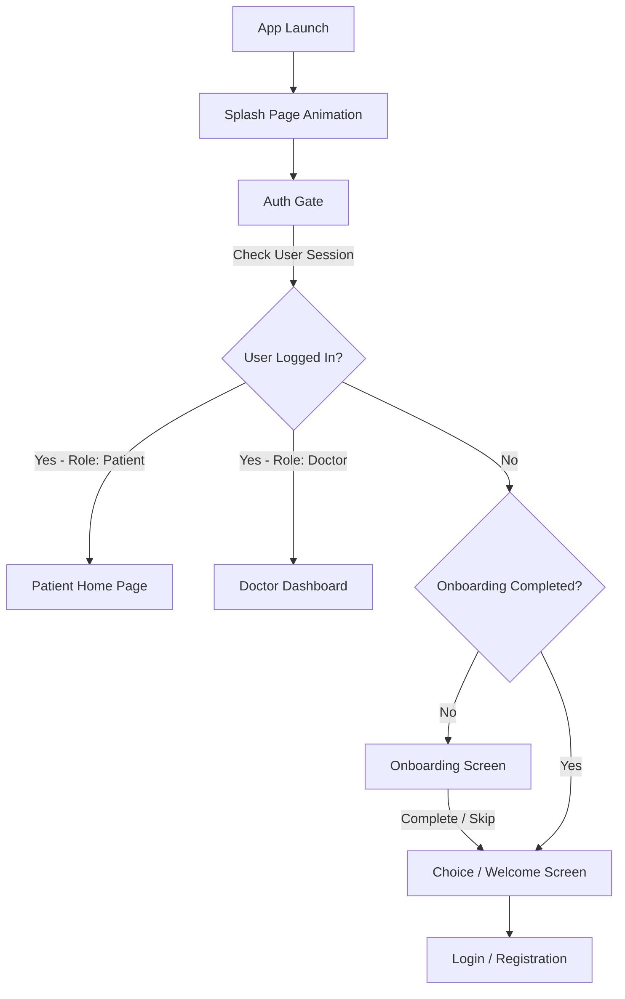

### 2. Appointment Booking Lifecycle
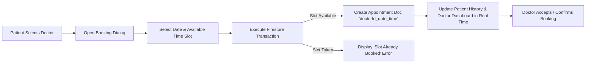

---

## 💡 Key Engineering Highlights

* **Atomic Slot Reservation:** Appointment bookings use Cloud Firestore transactions with composite document IDs (`${doctorId}_${date}_${time}`). This mathematically prevents race conditions and simultaneous double-booking attempts.
* **Chronological DateTime Parsing:** Appointment sorting parses date strings (`YYYY-MM-DD`) and time strings (`10:00 ص`, `02:00 م`) into native `DateTime` objects, ensuring chronological sorting across Arabic/English time representations.
* **Working Hours Resilience:** Smart parsing algorithms automatically adapt 12-hour format entries (e.g., `10 AM` to `6`), converting end hours to PM time (`18:00`) seamlessly.
* **ScreenUtil Initialization:** Global `ScreenUtilInit` wrapping in `main.dart` guarantees responsive scaling without uninitialized late variable exceptions.

---

## 🔮 Future Enhancements

- [ ] Integration of Firebase Storage for profile photo uploads.
- [ ] Push notifications using Firebase Cloud Messaging (FCM) for appointment status changes.
- [ ] In-app chat feature between patients and doctors.
- [ ] Integration of online payment gateways for appointment prepayments.
- [ ] Multi-language support (English alongside Arabic).

---

## ✒️ Author & Developer

<div align="center">

  ### **Developed by Ahmed Abbas**
  *Senior Software Engineer & Mobile Application Developer*

  [](https://github.com/ahmedabbas06)
  [](https://www.linkedin.com/in/ahmed-abdullah-abbas/)

  * **GitHub Profile:** [@ahmedabbas06](https://github.com/ahmedabbas06)
  * **LinkedIn Profile:** [Ahmed Abdullah Abbas](https://www.linkedin.com/in/ahmed-abdullah-abbas/)

</div>
